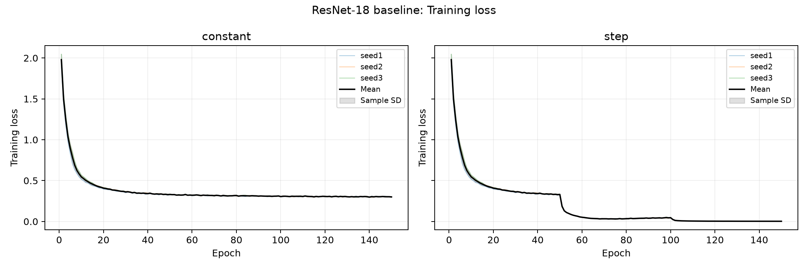
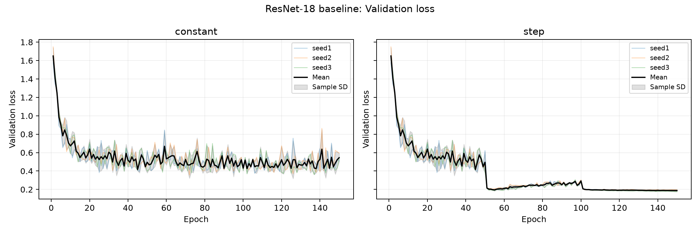
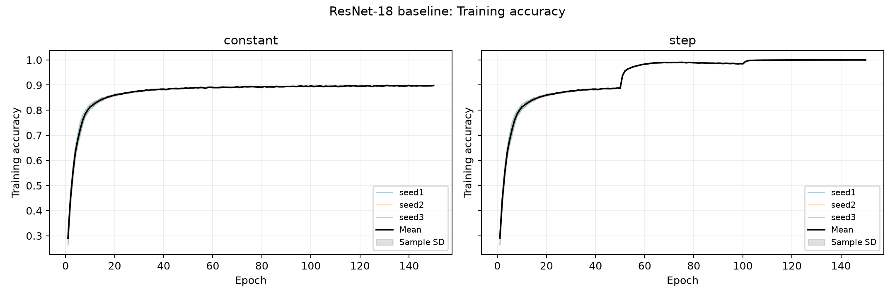
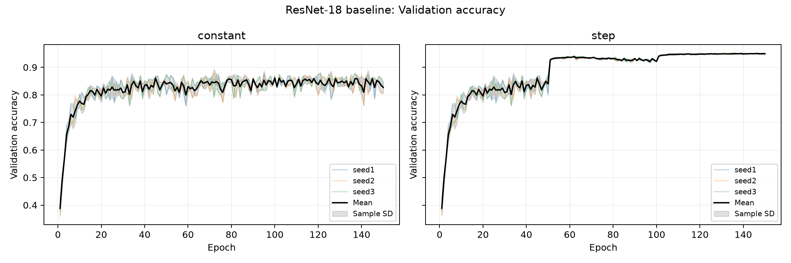
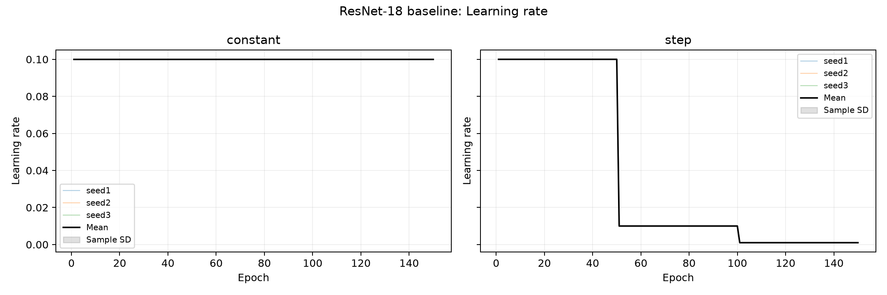

# Week 3 - Reliable ResNet-18 Baseline

Primary baseline: StepLR. Fixed LR is the conventional comparison. Existing completed runs are reused; no retraining.

## Configuration

CIFAR-10; CIFAR-adapted ResNet-18; CrossEntropyLoss; SGD, momentum 0.9, weight decay 5e-4; batch 128; 150 epochs; initial LR 0.1; training seeds 1/2/3; split_seed=1; 45,000 train / 5,000 validation / 10,000 test. Training augmentation: random crop (padding 4), random horizontal flip; CIFAR-10 normalization. Validation/test: normalization only.

StepLR: step_size=50, gamma=0.1 (LR 0.1 for epochs 1-50, 0.01 for 51-100, 0.001 for 101-150). Fixed LR remains 0.1. Hardware/software and full frozen configuration are recorded in the linked artifacts.

[Configuration](tables/configuration.json) | [Pilot environment](../../../lr_pilots/20261016_110243_fixedmomentum_split1_seed1/environment.json). The environment record was captured at the pilot stage; no separate full package inventory was captured per formal run.

## Results

| scheduler | seed | best_epoch | best_val_acc | final_val_acc | test_acc | final_train_loss | final_val_loss | training_time_seconds |
| --- | --- | --- | --- | --- | --- | --- | --- | --- |
| constant | 1 | 95 | 0.8780 | 0.8336 | 0.8683 | 0.3040 | 0.5071 | 2916.2405 |
| constant | 2 | 72 | 0.8838 | 0.8046 | 0.8708 | 0.3000 | 0.5970 | 3530.3162 |
| constant | 3 | 137 | 0.8796 | 0.8426 | 0.8722 | 0.2970 | 0.5314 | 2996.8759 |
| step | 1 | 135 | 0.9506 | 0.9490 | 0.9456 | 0.0024 | 0.1917 | 2886.9879 |
| step | 2 | 146 | 0.9494 | 0.9480 | 0.9451 | 0.0024 | 0.1962 | 3456.0733 |
| step | 3 | 136 | 0.9524 | 0.9508 | 0.9483 | 0.0023 | 0.1756 | 2898.3814 |

Accuracy is a fraction (0-1). Losses are final-epoch values. Test accuracy uses the best-validation checkpoint, not the final epoch. Recorded duration includes the final test evaluation; pure epoch-time sums are in the CSV. SD is sample standard deviation across three seeds, not a confidence interval.

[Per-run CSV](tables/baseline_runs.csv) | [Mean and SD](tables/baseline_mean_std.csv)

## Observations

- step: best validation 95.08% +/- 0.15 percentage points; final validation 94.93%; test 94.63% +/- 0.17 percentage points; mean recorded duration 51.34 minutes.
- constant: best validation 88.05% +/- 0.30 percentage points; final validation 82.69%; test 87.04% +/- 0.20 percentage points; mean recorded duration 52.46 minutes.

In these runs, StepLR improves mean test accuracy by 7.59 percentage points over fixed LR. Its final validation accuracy (94.93%) remains close to its best validation accuracy (95.08%), while fixed LR ends at 82.69% versus a best of 88.05%, indicating poorer late-stage stability. StepLR's final mean training/validation losses are 0.00236/0.18781, compared with 0.30032/0.54519 for fixed LR. The low StepLR training loss and remaining validation loss warrant monitoring generalisation; they do not invalidate the verified training pipeline.

Use the curves below to assess the effect of step reductions, validation oscillations and the train/validation gap. Training metrics include augmentation and train-mode batch normalization, while validation uses evaluation mode, so a gap alone does not establish overfitting. Three seeds give a preliminary estimate of variation, not proof of statistical superiority. No additional tuning was performed for this report.

## Correctness and version

All six checkpoints passed validation reevaluation and all 900 epoch records passed numeric/LR checks. [Verification details and limitations](verification.md). Recorded Git commit: `55d4d41`; protocol: `fixed-momentum-fixed-split-v2`. The exact training version is identified by the source hash and pilot source snapshot because the code was not fully committed. No GitHub upload was performed.

## Figures

### Training loss

### Validation loss

### Training accuracy

### Validation accuracy

### Learning rate

