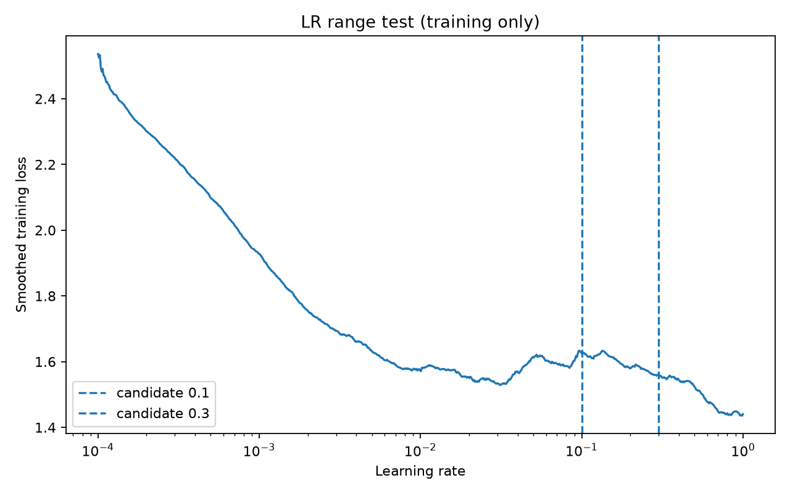
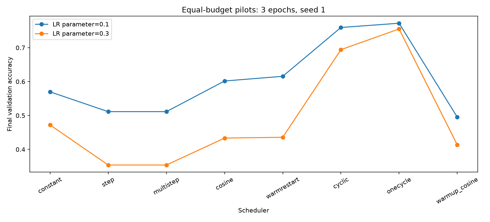
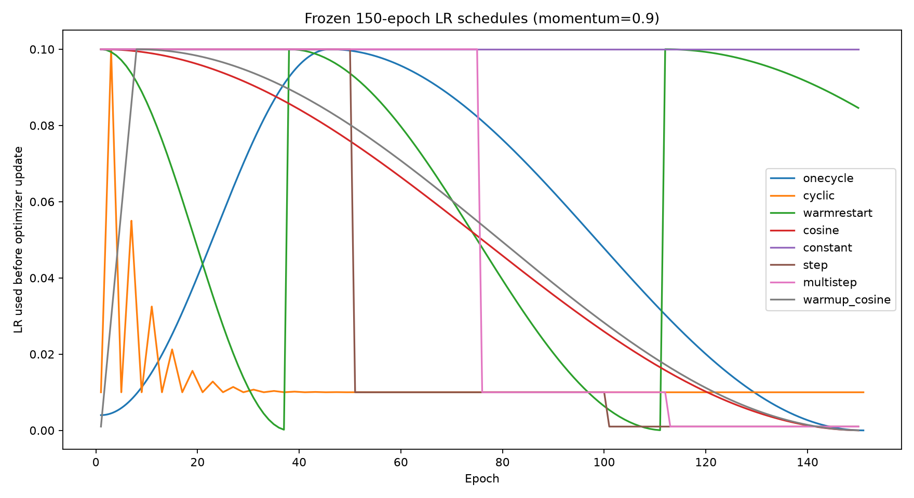

# LR pilot and frozen protocol v2

Training-only exponential LR range test; equal-budget validation-only pilots.
Each method: 2 candidates x 3 epochs, seed=1, split_seed=1.
Momentum=0.9, weight decay=5e-4; momentum cycling disabled.

Selection uses final validation accuracy, then validation loss, then lower LR. Test set was not evaluated.
These short pilots are an economical screening, not a definitive hyperparameter search.
Schedule durations scale to 150 epochs in the frozen configuration.







Selected settings:

```csv
scheduler,candidate_lr,final_val_acc,final_val_loss
onecycle,0.1,0.7722,0.645010986328125
cyclic,0.1,0.7596,0.6990708738327026
warmrestart,0.1,0.6156,1.0868661325454712
cosine,0.1,0.6018,1.1218048192977903
constant,0.1,0.5698,1.2730352537155152
step,0.1,0.5114,1.3241386726379394
multistep,0.1,0.5114,1.3241386726379394
warmup_cosine,0.1,0.4952,1.3720628704071045
```

Use formal_config.json and source_snapshot/ together for the next experiments.
Previous cyclic/OneCycle results changed momentum and cannot be pooled with v2.
Do not start the three-seed main comparison until this pilot has been reviewed.
