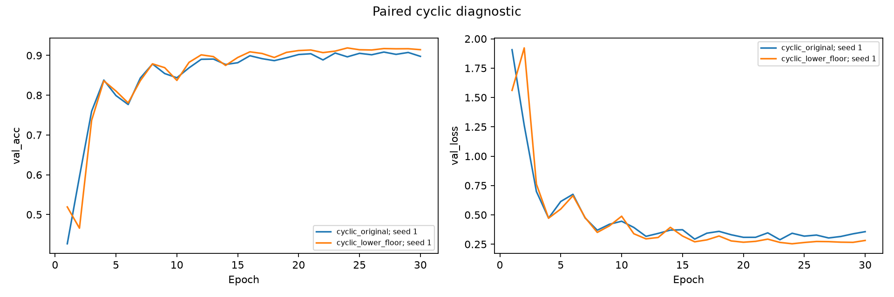
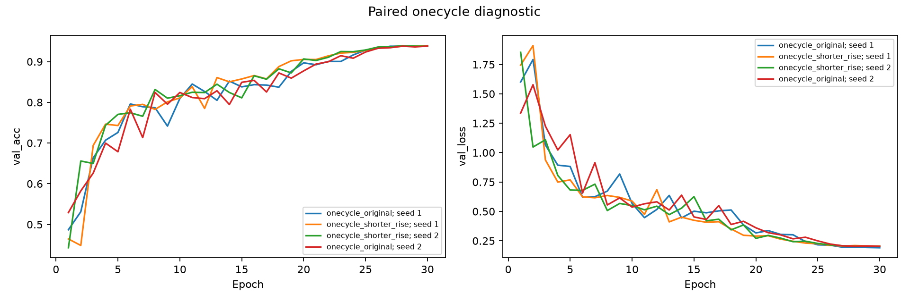
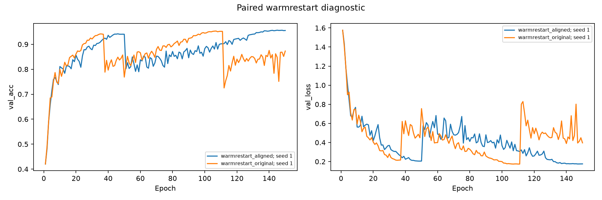
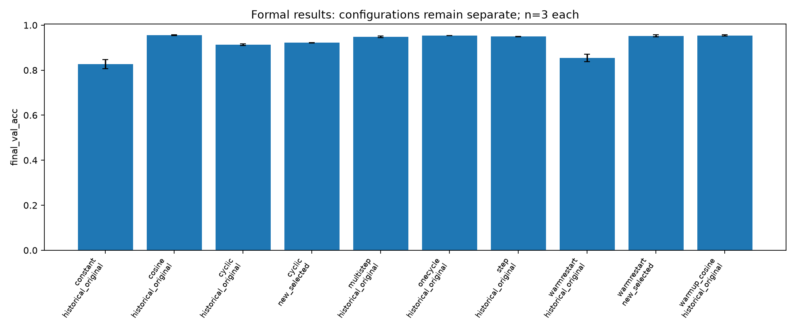
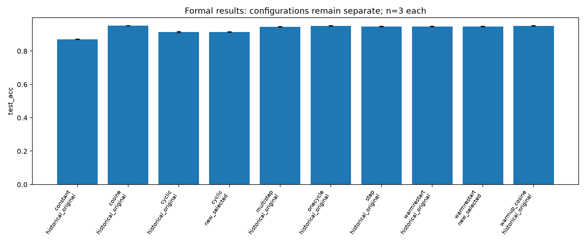
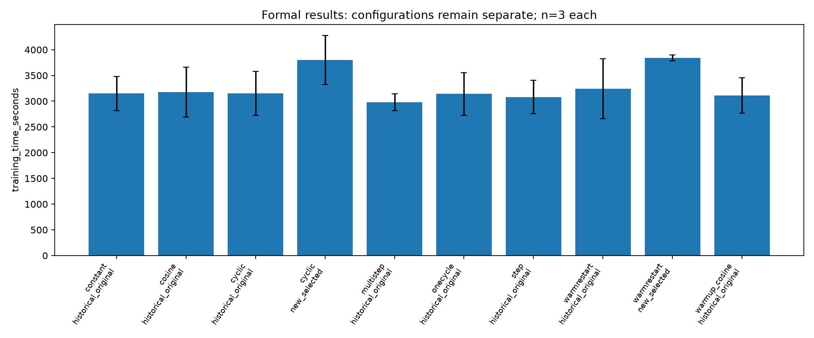

# Diagnostic results

Selection uses validation only. Test scores are descriptive after selection.

## cyclic

## onecycle

## warmrestart

## Formal comparison

Tables retain historical and new configuration groups separately. Do not pool them or infer significance from three runs.